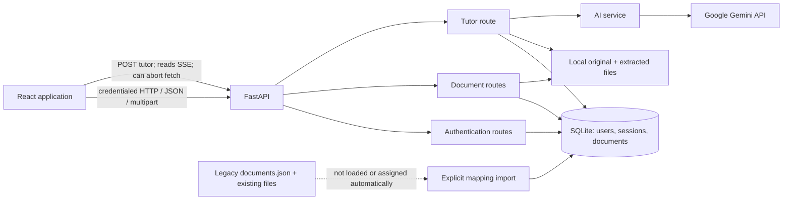
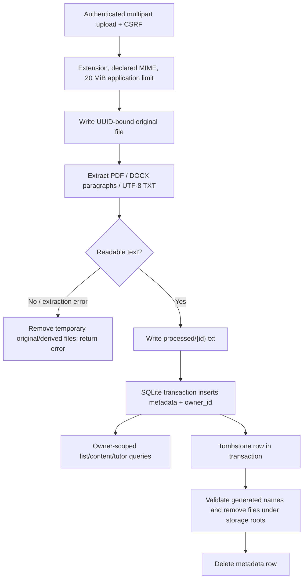
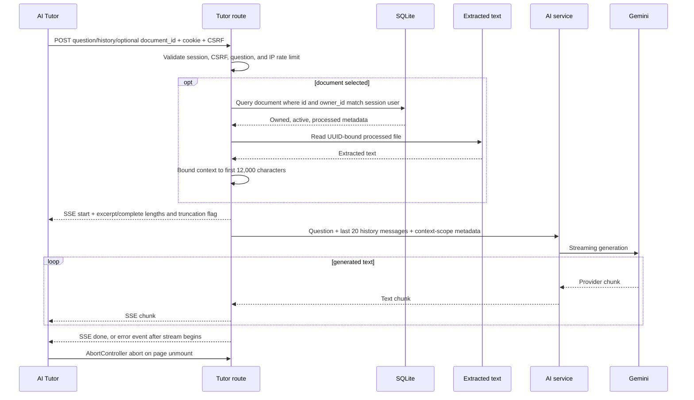

# StudyGen AI Architecture

This describes the implemented application after adding account sessions and per-user document ownership. It is not a production-readiness certification.

## System context



The React frontend is served by Vite in development. It calls the FastAPI backend at `VITE_API_URL`; if unset, Vite development uses the current frontend hostname on port `8000`, while production uses the current origin. FastAPI CORS permits credentialed requests only from the configured frontend origin(s).

## Frontend modules and auth state

- [`frontend/src/main.jsx`](../frontend/src/main.jsx) mounts the app inside React Strict Mode.
- [`frontend/src/App.jsx`](../frontend/src/App.jsx) preserves the Dashboard, Documents, AI Tutor, Quizzes, Flashcards, Progress, and Settings routes. The existing application shell is behind an authentication gate; `/login` and `/register` render the account form.
- [`frontend/src/auth/AuthContext.jsx`](../frontend/src/auth/AuthContext.jsx) restores the current session from `/api/auth/me`, holds the public user and CSRF token in React memory, and handles logout/expired-session events.
- [`frontend/src/lib/api.js`](../frontend/src/lib/api.js) sends requests with `credentials: "include"` and adds `X-CSRF-Token` to unsafe requests. The session credential is never copied into JavaScript storage or logs.
- [`frontend/src/components/Topbar.jsx`](../frontend/src/components/Topbar.jsx) displays the signed-in email and sign-out action.
- [`frontend/src/pages/Documents.jsx`](../frontend/src/pages/Documents.jsx) lists, uploads, and deletes the current user's documents and links a processed document to the tutor.
- [`frontend/src/pages/AITutor.jsx`](../frontend/src/pages/AITutor.jsx) submits general or selected-document questions, parses SSE events, and retains its `AbortController` cancellation on component unmount.
- Quizzes, Flashcards, Progress, and Settings remain prototype pages. Their sample/transient UI is not connected to account-backed persistence.

Frontend route gating is only a user-experience measure. Backend routes independently validate the session and enforce ownership.

## Backend modules and API flow

- [`backend/main.py`](../backend/main.py) loads environment configuration before importing route modules, configures credentialed CORS, registers auth/document/tutor routers, and initializes SQLite migrations during application startup.
- [`backend/routes/auth.py`](../backend/routes/auth.py) validates registration/login inputs, issues/revokes sessions, and limits authentication attempts per client IP in the current process.
- [`backend/services/auth.py`](../backend/services/auth.py) hashes passwords with Argon2, validates the opaque session cookie, checks expiry, enforces CSRF on state-changing authenticated routes, and validates the request Origin for login/registration.
- [`backend/database.py`](../backend/database.py) opens SQLite connections and applies sequential SQL migrations transactionally using `PRAGMA user_version`.
- [`backend/migrations/001_identity_and_documents.sql`](../backend/migrations/001_identity_and_documents.sql) defines users, server-side sessions, and owner-linked document metadata.
- [`backend/routes/documents.py`](../backend/routes/documents.py) performs extraction and executes owner-scoped document queries. Files remain local under `backend/uploads/documents/` and `backend/uploads/processed/`.
- [`backend/routes/tutor.py`](../backend/routes/tutor.py) validates/rate-limits a request, checks optional document ownership, reads that owner's text, and returns `StreamingResponse`.
- [`backend/services/ai_service.py`](../backend/services/ai_service.py) assembles prompt content and streams Gemini output.

The backend is authoritative for identity: route code receives the user ID only from the validated server-side session. No route trusts a user ID supplied in JSON, form fields, or query parameters.

## Authentication/session flow

```mermaid
sequenceDiagram
    participant UI as Browser
    participant Auth as FastAPI auth
    participant DB as SQLite
    UI->>Auth: POST register/login (Origin, email, password)
    Auth->>Auth: Validate Origin, schema, rate limit; Argon2 verify/hash
    Auth->>DB: Transactionally create user/session
    DB-->>Auth: User + random session + CSRF token
    Auth-->>UI: HttpOnly session cookie + public user + CSRF token
    UI->>Auth: GET /api/auth/me (cookie)
    Auth->>DB: Hash cookie; resolve unexpired session/user
    DB-->>Auth: user + CSRF token
    Auth-->>UI: public session state
    UI->>Auth: Unsafe request (cookie + X-CSRF-Token)
    Auth->>DB: Validate session and CSRF association
```

The cookie contains a cryptographically random opaque session value; SQLite stores its SHA-256 digest, user ID, CSRF token, creation time, and 12-hour expiry. The session cookie is HttpOnly, `SameSite=Lax` by default, and Secure when configured/derived for HTTPS. For a cross-site frontend/API deployment, configure `SESSION_COOKIE_SAMESITE=none` together with `SESSION_COOKIE_SECURE=true` and HTTPS. The CSRF token is kept in frontend memory and returned by the authenticated `/me` route after reload.

Registration is open. Passwords are 12–128 characters and Argon2-hashed. Email addresses are validated/normalized but not verified; no password reset or email delivery flow exists. Auth-attempt limiting is process-local (10 registration/login attempts per client IP per 60 seconds) and is not a distributed abuse-control mechanism.

## Document ingestion, persistence, and ownership



The original filename is display metadata only; the on-disk name is generated from a UUID and the allowed extension. The extracted text is written to `{document_id}.txt`. Metadata fields include the owner, original/processed filenames, type, byte size, state, timestamps, and extracted-text length; extracted text itself is not stored in SQLite.

All list/content/delete/tutor lookups include the authenticated owner. An unknown ID and another user's ID both return `404`. Stored filenames are checked as basenames, matched to the document UUID and expected suffix, resolved under the configured storage directory, and never accepted directly from request input.

Upload writes and extracts files before committing the metadata transaction. On failure the route attempts cleanup and returns a non-success status; it never reports a successful document if metadata insertion failed. Deletion first commits a hidden tombstone, then removes both files, then deletes the database row. If cleanup or the final DB deletion fails, the operation returns `503`; a retry can finish cleanup. The database and filesystem cannot participate in one atomic transaction, so operators must still monitor storage errors and orphaned files.

### Existing ownerless records

At startup the app no longer loads or exposes `backend/uploads/documents.json`. That JSON and its files remain in place as an inaccessible legacy archive; there is no automatic assignment to the first account. [`backend/scripts/import_legacy_documents.py`](../backend/scripts/import_legacy_documents.py) supports an explicit manifest mapping selected legacy IDs to emails of accounts that already exist. It validates the complete mapping and filenames before a transaction. Default execution is a dry run; `--apply` commits metadata only. It does not rewrite the JSON or move/delete files. Back up the database and upload directories before a reviewed import.

## Database architecture and operational limits

SQLite is the authoritative store for users, sessions, and newly uploaded/imported document metadata. The Python standard-library `sqlite3` module applies numbered SQL migrations under a transaction; `PRAGMA user_version` prevents partial schema state and rejects schema versions newer than this code. By default the database is `backend/data/studygen.sqlite3`; `STUDYGEN_DATABASE_PATH` can override it. SQLite is appropriate for a single-host local application and transactional ownership records, but is not a multi-host shared database. The original and extracted files are still local plaintext files. There is no encryption-at-rest, centralized object storage, automated backup, retention, or distributed session/rate-limit layer.

## Tutor and Gemini sequence



The route resolves authorization and reads any document context before returning the stream, so foreign/unavailable documents fail as ordinary HTTP errors before Gemini is called. It supplies the complete extracted text up to 12,000 characters; larger extractions are reduced to the first 12,000 characters. The SSE `start` event reports whether the context is partial and the supplied/total extracted-character counts; the UI warns that later content may not be covered. Prompt instructions tell Gemini to prioritize document evidence, distinguish proposals from established implementation, flag contradictions, be transparent about excerpt scope, and label external knowledge. Page/section references are allowed only when present in the supplied text. These instructions do not guarantee factual grounding, contradiction detection, or prompt-injection resistance; no retrieval or citation validation exists. The browser aborts its fetch when the tutor page unmounts; server/provider-side cancellation and provider timeouts are not implemented or verified.

## Failure handling

- Missing/invalid/expired sessions return `401`; disallowed Origin or invalid CSRF returns `403`.
- Document read/list/write/delete and authentication-storage failures return controlled errors; logs avoid document text and credentials.
- Registration/login and authenticated ownership are separate from CORS and frontend route gates.
- Gemini/provider errors after SSE starts are logged server-side and returned as a generic `error` event with HTTP `200`.
- `/health` reports process status only and is not a live database/Gemini readiness probe.

## Remaining limitations

- Local files and SQLite are plaintext and host-bound; backups, encryption-at-rest, multi-host deployment, disaster recovery, and shared rate limiting are not configured.
- Registration has no email verification or password recovery; auth throttling is per-process.
- Upload MIME/extension checks do not validate file signatures or scan for malware. Parsing has no explicit CPU/memory timeout, and the application-level 20 MiB check happens while reading the request.
- Authenticated XSS could issue requests as the user. CSRF controls do not mitigate XSS.
- Document text sent for document-aware tutoring is processed by Google Gemini; review provider data-handling requirements before using sensitive content.
- Dashboard, quiz, flashcard, progress, and settings experiences remain static or transient prototypes.
- There is no live Gemini, browser end-to-end, multi-worker, or production deployment verification.
